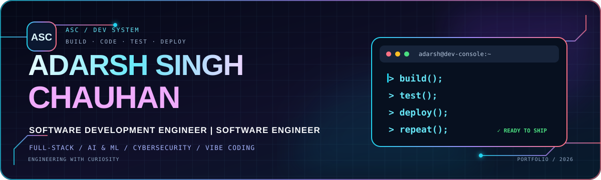

<p align="center">
  <a href="https://adarsh-singh-chauhan.github.io/adarsh-portfolio/">
    
  </a>
</p>

<p align="center">
  
</p>

<p align="center">
  <a href="https://adarsh-singh-chauhan.github.io/adarsh-portfolio/"></a>
  <a href="https://www.linkedin.com/in/adarsh-singh-5189b9283/"></a>
  <a href="https://github.com/Adarsh-Singh-Chauhan"></a>
  <a href="mailto:adarshsinghchauhan28@gmail.com"></a>
</p>

<p align="center">
  
  
  
  
  
</p>

---

## ◈ The project

A personal developer portfolio designed as a cinematic, dark-mode engineering experience. It brings together my profile, technical interests, selected builds, credentials and contact links in one responsive single-page website.

**Live portfolio:** [adarsh-singh-chauhan.github.io/adarsh-portfolio](https://adarsh-singh-chauhan.github.io/adarsh-portfolio/)

### Interface highlights

| Experience | What you'll find |
|---|---|
| **Interactive hero** | Animated introduction, gradient typography, typing text and quick links |
| **3D background** | Three.js-powered canvas scene with pointer-responsive movement |
| **About & profile** | Education, focus areas, location and opportunity interests |
| **Technical skills** | Categorized engineering skills with animated skill bars |
| **Featured builds** | Six project groups spanning AI, full-stack, ML, blockchain, IoT and real-time apps |
| **Credentials** | Certifications, hackathon participation and achievements |
| **Motion & interaction** | Scroll-reveal sections, custom cursor, hover states and smooth navigation |

## 👨‍💻 About me

I'm **Adarsh Singh Chauhan**, a Computer Science & Engineering student specializing in Cyber Security at **SIRT, Bhopal (RGPV)**.

I enjoy building practical software across full-stack development, AI/ML and cybersecurity. I like taking an idea from a problem statement to a working product—designing the interface, building the application logic, integrating models or APIs, and validating the result.

- **Education:** B.Tech CSE — Cyber Security
- **Institute:** SIRT, Bhopal · RGPV University
- **Academic score:** 8.3 / 10 CGPA
- **Expected graduation:** 2027
- **Based in:** Bhopal, Madhya Pradesh, India
- **Current interests:** Software engineering, full-stack products, AI applications, security and automation

## 🧰 Technology map

<p align="center">
  
  
  
  
  
  
  
  
  
  
  
  
</p>

| Area | Tools & concepts |
|---|---|
| **Languages** | Python, JavaScript, TypeScript, Solidity |
| **Frontend** | HTML, CSS, React.js, Vite, Tailwind CSS |
| **Backend & APIs** | Node.js, Express.js, REST APIs, JWT authentication, Socket.io |
| **AI / ML / NLP** | Scikit-learn, XGBoost, mBERT, XLM-RoBERTa, Hugging Face, CNN, RNN, feature engineering |
| **Data & storage** | MongoDB, Firebase Firestore, PostgreSQL, MySQL |
| **Cybersecurity** | Network security, threat-detection workflows, misinformation and coordinated-account analysis |
| **Blockchain / Web3** | Solidity, Ethereum, smart contracts, Django |
| **IoT / hardware** | Arduino, Raspberry Pi, ESP8266, DHT11, Blynk, ThingSpeak |

## 🚀 Featured projects

The following projects are showcased in the portfolio website. Open the live site for the full presentation and project details.

<table>
  <tr>
    <td width="50%" valign="top">
      <h3>01 · DRISHTI</h3>
      <strong>AI-assisted campaign & misinformation detection</strong>
      <p>A multilingual detection platform focused on propaganda, hate speech and misinformation targeting India.</p>
      <sub>mBERT · XLM-RoBERTa · React · Node.js · Firebase · Gemini · NetworkX</sub>
    </td>
    <td width="50%" valign="top">
      <h3>02 · Supermarket Billing AI POS</h3>
      <strong>Full-stack point-of-sale & inventory intelligence</strong>
      <p>A billing and inventory application concept with barcode workflows, GST invoices, demand forecasting and analytics.</p>
      <sub>TypeScript · React · Node.js · Express · MongoDB · Machine Learning</sub>
    </td>
  </tr>
  <tr>
    <td width="50%" valign="top">
      <h3>03 · LearnToEarn</h3>
      <strong>Blockchain-powered learning rewards</strong>
      <p>An educational rewards platform using Ethereum smart contracts and a Django backend.</p>
      <sub>Solidity · Ethereum · Django · PostgreSQL · Python · Web3</sub>
    </td>
    <td width="50%" valign="top">
      <h3>04 · Disease Prediction ML</h3>
      <strong>Healthcare risk prediction experiments</strong>
      <p>End-to-end disease and heart-disease prediction workflows with model comparison and evaluation.</p>
      <sub>Python · Scikit-learn · XGBoost · Pandas · NumPy · Jupyter</sub>
    </td>
  </tr>
  <tr>
    <td width="50%" valign="top">
      <h3>05 · IoT Smart Dustbin & Plant Monitor</h3>
      <strong>Connected hardware prototypes</strong>
      <p>Sensor-driven waste-level monitoring and plant-health monitoring with cloud-connected data and alerts.</p>
      <sub>Arduino · Raspberry Pi · ESP8266 · DHT11 · Firebase · Blynk · ThingSpeak</sub>
    </td>
    <td width="50%" valign="top">
      <h3>06 · Vakyam & Retired Mentor</h3>
      <strong>Real-time communication & mentorship platforms</strong>
      <p>A WebRTC video-conferencing application and a mentorship platform with authentication, chat and meeting workflows.</p>
      <sub>WebRTC · Socket.io · React · Node.js · MongoDB · JWT</sub>
    </td>
  </tr>
</table>

<p align="center">
  <a href="https://adarsh-singh-chauhan.github.io/adarsh-portfolio/#projects"><strong>EXPLORE THE PROJECT SHOWCASE ↗</strong></a>
</p>

## 🏅 Certifications & credentials

- Microsoft Azure — Computer Vision App Project
- Google — AI Fundamentals
- Cisco Networking Academy — Introduction to Cybersecurity
- Oracle — Certified Foundations Associate
- freeCodeCamp — Data Analysis with Python
- IBM SkillsBuild — AI & Cloud (with Letter of Recommendation)

## 🏆 Highlights

- **1st Place** — Gravition Science Model Competition, IoT Smart Dustbin project
- **Participant** — Edu Blockchain Hackathon, LearnToEarn platform
- **Campus Ambassador** — IIT Kanpur Techkriti '24

---

## 🖥️ Run locally

This repository is a lightweight static website. There is no npm install or bundler step required.

### 1. Clone the repository

```bash
git clone https://github.com/Adarsh-Singh-Chauhan/adarsh-portfolio.git
cd adarsh-portfolio
```

### 2. Start a local web server

Using Python:

```bash
python -m http.server 8080
```

Or using Node.js:

```bash
npx serve .
```

### 3. Open the website

Visit [http://localhost:8080](http://localhost:8080).

> **Note:** The Three.js library and Google Fonts are loaded from external CDNs, so an internet connection is needed for those resources.

## 📁 Repository structure

```text
adarsh-portfolio/
├── assets/
│   └── portfolio-readme-banner.svg   # Animated README banner
├── index.html                        # Portfolio markup, styles and scripts
├── README.md                         # Project documentation
└── LICENSE                           # MIT License
```

## 🌐 Deployment

The live website is published with **GitHub Pages**:

1. Open the repository's **Settings → Pages**.
2. Choose **Deploy from a branch**.
3. Select the `main` branch and `/ (root)` folder.
4. Save the settings and use the published Pages URL.

**Live URL:** [https://adarsh-singh-chauhan.github.io/adarsh-portfolio/](https://adarsh-singh-chauhan.github.io/adarsh-portfolio/)

## 🤝 Connect

<p align="center">
  <a href="https://www.linkedin.com/in/adarsh-singh-5189b9283/"></a>
  <a href="https://github.com/Adarsh-Singh-Chauhan"></a>
  <a href="mailto:adarshsinghchauhan28@gmail.com"></a>
</p>

<p align="center">
  <strong>Build with curiosity. Engineer with purpose. Keep shipping. ⚡</strong>
</p>

<p align="center">
  <sub>Designed & built by Adarsh Singh Chauhan · Licensed under MIT</sub>
</p>
