<p align="center">
  
</p>

<p align="center">
  
</p>

<p align="center">
  <a href="https://adarsh-singh-chauhan.github.io/adarsh-portfolio/"></a>
  <a href="https://github.com/Adarsh-Singh-Chauhan"></a>
  <a href="https://www.linkedin.com/in/adarsh-singh-5189b9283/"></a>
  <a href="LICENSE"></a>
</p>

<h2 align="center">⚡ A PORTFOLIO BUILT LIKE A DIGITAL EXPERIENCE</h2>

<p align="center">
  An interactive, dark-theme developer portfolio showcasing software projects, technical skills, credentials and achievements — with animated visuals and a responsive layout.
</p>

---

## 👨‍💻 About

I'm **Adarsh Singh**, a B.Tech Computer Science & Engineering student (Cyber Security) at **SIRT Bhopal, RGPV**.

I enjoy building practical software across full-stack development, AI/ML, cybersecurity, blockchain and IoT. This portfolio brings together selected work, technical interests and ways to connect.

**Current focus:** Full-stack engineering · AI/ML applications · Cybersecurity · Software development

## ✨ Experience & interface features

| Feature | What it does |
|---|---|
| 🌌 Three.js particle environment | Animated 3D particle field with subtle camera movement |
| 🎨 Dynamic visual system | Dark interface with cyan–violet–pink gradient accents |
| ⌨️ Animated hero | Intro transitions, gradient typography and typing-style role text |
| 🧭 Smooth navigation | Fixed glass-style navigation with section anchors |
| 👀 Scroll reveal | Content cards animate into view as you explore |
| 📊 Skill indicators | Skill bars animate when their section enters the viewport |
| 🧩 Project cards | Hover interactions, project summaries and technology chips |
| 📱 Responsive layout | Adapts to desktop, tablet and mobile screens |
| ♿ Motion-aware UI | Respects the device's reduced-motion preference |

## 🧰 Tech stack

<p align="center">
  
  
  
  
  
  
</p>

**Typography:** Syne · Inter · JetBrains Mono  
**3D / motion:** Three.js · CSS keyframes · Intersection Observer

## 🚀 Featured projects

The website currently showcases these six project areas. Use the live portfolio to explore their full descriptions and technology details.

| Project | Focus | Explore |
|---|---|---|
| **DRISHTI — Anti-India Campaign Detection** | Multilingual NLP, threat detection, misinformation analysis and real-time dashboards | [Portfolio section](https://adarsh-singh-chauhan.github.io/adarsh-portfolio/#projects) |
| **Supermarket Billing AI POS** | Full-stack point-of-sale, barcode workflows, inventory forecasting and analytics | [Portfolio section](https://adarsh-singh-chauhan.github.io/adarsh-portfolio/#projects) |
| **LearnToEarn** | Blockchain education platform with Ethereum smart contracts and learning rewards | [Portfolio section](https://adarsh-singh-chauhan.github.io/adarsh-portfolio/#projects) |
| **Disease Prediction ML** | Healthcare risk-prediction pipelines and model evaluation | [Portfolio section](https://adarsh-singh-chauhan.github.io/adarsh-portfolio/#projects) |
| **IoT Smart Dustbin & Plant Health Monitor** | Arduino, ESP8266, sensors and cloud-connected monitoring | [Portfolio section](https://adarsh-singh-chauhan.github.io/adarsh-portfolio/#projects) |
| **Vakyam & Retired Mentor Platform** | WebRTC video conferencing, real-time communication and mentorship workflows | [Portfolio section](https://adarsh-singh-chauhan.github.io/adarsh-portfolio/#projects) |

## 🏅 Certifications & credentials

- Microsoft Azure — Computer Vision App Project
- Google — AI Fundamentals
- Cisco Networking Academy — Introduction to Cybersecurity
- Oracle — Certified Foundations Associate
- freeCodeCamp — Data Analysis with Python
- IBM SkillsBuild — AI & Cloud

## 🏆 Awards & achievements

- **1st Place — Gravition Science Model Competition:** IoT Smart Dustbin with real-time waste-level monitoring.
- **Edu Blockchain Hackathon:** Participant with the LearnToEarn educational rewards platform.
- **IIT Kanpur Techkriti '24:** Campus Ambassador.

## 🖥️ Run locally

This repository is a lightweight static website. There is no npm build step.

```bash
# 1. Clone the repository
git clone https://github.com/Adarsh-Singh-Chauhan/adarsh-portfolio.git

# 2. Open the project folder
cd adarsh-portfolio

# 3. Start a local static server
python -m http.server 5500
```

Open **http://localhost:5500** in your browser.

You can also open `index.html` directly, or use the VS Code Live Server extension. The page loads Google Fonts and Three.js from their CDN, so an internet connection is needed for the complete visual experience.

## 📁 Repository structure

```text
adarsh-portfolio/
├── assets/
│   └── adarsh-portfolio-banner.svg
├── index.html
├── README.md
└── LICENSE
```

## 🌐 Live website

<p align="center">
  <a href="https://adarsh-singh-chauhan.github.io/adarsh-portfolio/">
    
  </a>
</p>

**Live URL:** https://adarsh-singh-chauhan.github.io/adarsh-portfolio/

## 🤝 Connect

<p align="center">
  <a href="https://www.linkedin.com/in/adarsh-singh-5189b9283/"></a>
  <a href="https://github.com/Adarsh-Singh-Chauhan"></a>
  <a href="mailto:adarshsinghchauhan28@gmail.com"></a>
</p>

<p align="center">
  <strong>Thanks for visiting — build useful things, keep learning, and ship with purpose. ✨</strong>
</p>

<p align="center">
  <sub>Designed & built by Adarsh Singh · SIRT Bhopal · RGPV</sub>
</p>
